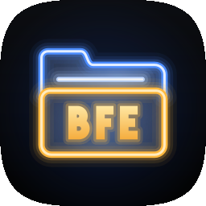

<p align="center">
  
</p>

<h1 align="center">Banners File Explorer (BFE)</h1>

<p align="center">
  <b>A full-featured, sideload-only file manager for Android</b><br>
  Dual-pane browsing, on-device extraction of archives, disc images and game installers, a VLC-powered
  media player, a document viewer, cloud and network access, hardware-encrypted sign-ins and a Wi-Fi
  file server — in one app with a modern <b>Aurora Glass</b> interface.
</p>

<p align="center">
  <a href="https://github.com/The412Banner/BFE/releases/latest"><b>Download the latest release</b></a>
  · Android 8.0+ · arm64 · GPL-3.0 · <code>com.the412banner.bfe</code>
</p>

Banners File Explorer grew out of the file manager and archive subsystem of the
[Bannerlator](https://github.com/The412Banner/Bannerlator) emulator (Winlator lineage). The emulator
machinery is gone; the browse / extract / manage core is now its own app.

---

## Contents
- [Features](#features)
- [Requirements & permissions](#requirements--permissions)
- [Install & updates](#install--updates)
- [Building from source](#building-from-source)
- [Project structure](#project-structure)
- [Known limitations](#known-limitations)
- [License](#license)
- [Credits](#credits)

---

## Features
Tap any line for the details.

<details>
<summary><b>Home dashboard</b> — storage, media, apps, cloud and network at a glance</summary>

- Tiles with live stats, four across on a typical phone (three on narrow screens, more in landscape),
  each with its name on top, its icon and the numbers below, sized to fit any screen and font size:
  **Main storage** (used / total with a usage bar), **SD card / USB**
  drives, **System** (`/`, read-only without root), **Downloads**, **Images**, **Audio**, **Videos**,
  **Documents**, **New files** (last 7 days), **Apps**, **Cloud**, **Remote** and **Access from network**.
- **Favorites** row, and *Settings → Start on* to open on Home or on the last folder.

</details>

<details>
<summary><b>App storage tiles</b> — pin other apps' storage to Home with <b>+</b></summary>

- Add any app that shares its files through Android's document access, or — with root — any app's
  private data folder; each appears as its own small tile with the app's icon.
- Tap to open it in the file manager, long-press to remove it (nothing on the storage is touched).

</details>

<details>
<summary><b>Dual-pane file manager</b> — two panes side by side in portrait and landscape</summary>

- Two independent panes split down the middle, each with its own folder, sort and selection; both
  always show the same view (List or Compact), with slim rows and short dates so full names fit.
- Draggable divider (snaps to ⅓ · ½ · ⅔, double-tap for 50/50), one-tap **Copy → / Move →** into the
  other pane, and extraction straight into the other pane's folder.

</details>

<details>
<summary><b>Views, sorting & details</b> — grid, list or compact; folders A→Z then newest files</summary>

- **Grid, List and Compact** views (dual pane: List and Compact, both panes always alike), clickable breadcrumb with free space, search, hidden files.
- Separate orders for folders and files — default **folders A→Z, then newest files first** — with
  natural name order ("Disc 2" before "Disc 10").
- Item counts, sizes and **date + time** of the last change on every row (date over time in list cards).
- Lists **refresh in place** when you return to the app — no scrolling to the top to see changes.

</details>

<details>
<summary><b>File operations</b> — copy, move, rename, delete and share with progress and conflict handling</summary>

- Multi-select with copy, cut, paste, delete, share, compress and extract.
- Real progress, cancel, and overwrite / merge / keep both / skip choices.
- New folder / new file, rename, properties (with a separate *Created* time when the filesystem records
  one) and a read-only toggle; favourites.

</details>

<details>
<summary><b>Thumbnails & icons</b> — photo and video previews, APK and EXE icons, BFE's own file icons</summary>

- Photo thumbnails and **video frames** (from ~1 s in), real **APK launcher icons** and **`.exe` icons**.
- BFE's own artwork everywhere else: manila folders with emblems for special folders (Download,
  Pictures, Music, Movies, Documents, Android, Games, Backups) and colour-coded file types.

</details>

<details>
<summary><b>Tap to open in BFE</b> — files open in BFE's own viewers whenever it has one</summary>

- A tap opens photos, videos and music in the viewer and player, documents and text in the document
  viewer, web pages in the HTML viewer, archives and disc images as folders, and APKs in the installer —
  inside archives too.
- Anything else shows the Open with sheet, and **⋮ → Open with** shows it for every file.

</details>

<details>
<summary><b>Open with sheet</b> — BFE's actions first, then every app that can open the file</summary>

- BFE's own actions for the file (View, Play, View page, Open as folder, Extract, Install, Clone,
  Convert, Properties), then the installed apps, with *Open as* type chips.
- *Always use for .ext* remembers a default per file type (managed in Settings); it's listed first and
  marked, and the sheet still shows.

</details>

<details>
<summary><b>Aurora Glass & Classic looks</b> — frosted-glass design or the original interface</summary>

- **Aurora Glass** (default): frosted-glass panels over a soft drifting backdrop, a floating pill toolbar
  in portrait and a pill rail in landscape, a rising selection pill, glass sheets, menus and dialogs.
- Purposeful motion: direction-aware folder transitions, staggered lists, spring sheets; real backdrop
  blur on Android 12L+, a dense frosted fill on older versions; respects *Remove animations*.
- **Classic**: the original BFE interface. Switch instantly under **Settings → Look**.

</details>

<details>
<summary><b>Palettes & app icons</b> — six colour palettes and 21 launcher icons</summary>

- Palettes: **Neutral** (default), Aurora, Ocean, Ember, Forest and Rose — light and dark — plus
  Android 12+ dynamic colour.
- Launcher icon *Glass-Filled Neon* plus 20 alternatives under **Settings → App icon** — squircle on
  every launcher, with themed-icon variants.

</details>

<details>
<summary><b>Archive extraction</b> — 40+ formats with on-device engines</summary>

| Category | Formats | Engine |
|---|---|---|
| Common archives | 7z, zip, zipx, rar / rar5 (incl. multi-part), cab, arj, lzh / lha, cpio, xar, chm, wim / esd, msi | 7-Zip |
| Tar & compressors | tar, gz / tgz, bz2 / tbz, xz / txz, zst / tzst, lzma, Z, Winlator `.wcp` | 7-Zip |
| Packages | apk, xapk, apks, apkm, jar, deb, rpm, mtz | 7-Zip |
| Disc & disk images | iso, udf, img, bin / cue, cso, dmg, vhd / vhdx, vmdk, vdi, qcow, squashfs, cramfs | 7-Zip |
| Split volumes | .001, .z01, .r00 | 7-Zip |
| lzip · lzop · LZ4 | `.lz` / `.tlz`, `.lzo` / `.tzo`, `.lz4` | lunzip · lzop · lz4 |
| CD images | `.ecm` | unecm |
| Korean archives | `.alz`, `.egg` (incl. AZO, split, solid) | unalz · built-in EGG reader |
| Legacy | ACE 1.x `.ace`, Amiga `.lzx` | unace · amiga-lzx |
| Android OTA | `payload.bin` (full OTAs → partition images) | built-in |

Formats are recognised by their header, not only the extension; unsupported variants are explained before
starting.

</details>

<details>
<summary><b>Game installers & repacks</b> — GOG / InnoSetup setups and FreeArc repacks</summary>

- **InnoSetup / GOG** `setup_*.exe` unpacked with innoextract, including **automatic DLC batches**
  (sibling DLC installers merged into one game folder).
- **FreeArc / ISDone** repacks (`Setup-N.bin` volumes) decoded natively with unarc.

</details>

<details>
<summary><b>Background extraction</b> — notification progress with Pause, Cancel and a queue</summary>

- Runs as a foreground service: progress, speed and time left in the notification with
  **Pause / Resume / Cancel / Cancel all**, a **queue** of jobs, and an **Open folder** button when done.
- An app-wide progress pill inside BFE; survives the app going to the background.

</details>

<details>
<summary><b>System "Open with" integration</b> — extract from any app, one tap or full screen</summary>

- BFE appears for archives, disc images and installers in other apps' *Open with* lists — as **BFE**
  (the extract screen) and as a one-tap **Extract to ./&lt;Archive name&gt;/** that runs entirely in the
  background.
- Files shared from other apps are opened in place, or copied in when the sender hides their location.

</details>

<details>
<summary><b>Browse archives like folders</b> — open zip, 7z, rar, iso, apk and more in the pane</summary>

- Read-only, in the pane, with breadcrumbs (`…/folder › Game.zip › inner`); compressed tars and Winlator
  `.wcp` open straight into their contents.
- Tap a file inside to open it; multi-select → **Extract…**; password prompts for zip / 7z / rar; big
  archives list in the background and are cached.

</details>

<details>
<summary><b>Compression</b> — zip, 7z, tar, tar.gz, tar.xz, tzst and Winlator packs</summary>

- zip (optional AES-256 password), 7z (optional password, encrypted headers), tar, tar.gz, tar.xz, tzst.
- **Winlator `.wcp`** content packs (Wine, Proton, DXVK, VKD3D, Box64, FEXCore…) with the exact
  `profile.json` Bannerlator / Winlator read.

</details>

<details>
<summary><b>Video & music player</b> — libVLC playback of virtually any format, with VLC's effects</summary>

- Codecs and containers: HEVC, AV1, VP9, VC-1, WMV, DivX, MPEG-2, AC-3, DTS, TrueHD, FLAC, Opus and more;
  embedded, ASS/SSA, SRT and PGS subtitles.
- Gestures for seek, brightness and volume (boost to 200 %), double-tap ±10 s, hold for 2×, pinch-zoom,
  resume position and picture-in-picture.
- Effects sheet: **Picture** (brightness, contrast, saturation, hue, gamma, looks, aspect, crop, zoom,
  rotate / mirror), **Effects** (deinterlace, denoise, banding removal, deblocking, sharpen, film grain),
  **Audio** (10-band equalizer with presets, boost, A/V sync, speed with keep-pitch), **Subtitles**
  (tracks, delay, size, colour).
- Music plays with cover art and the folder as a playlist.

</details>

<details>
<summary><b>Photo viewer</b> — swipe, zoom, details and slideshow</summary>

- Swipe through a folder or category; pinch and double-tap zoom with tiled sub-sampling for large photos.
- GIF / animated WebP, EXIF orientation, details (resolution, camera, location), lossless JPEG rotation,
  slideshow, share, set as, delete.

</details>

<details>
<summary><b>Document viewer</b> — PDF, Word, Excel, PowerPoint, OpenDocument, EPUB, Markdown, RTF and text, offline</summary>

- **PDF**: pages top to bottom, pinch / double-tap zoom up to 5× (re-rendered sharp), page counter with
  Go to page, fast-scroll handle, night mode, print. Password-protected or damaged files say so.
- **Word (.docx) and OpenDocument text (.odt / .fodt)**: headings, bold / italic / underline / strike,
  colours and sizes, bulleted and numbered lists, tables with merged cells, links, footnotes, pictures,
  text boxes and page breaks — converted on the device, nothing is uploaded.
- **Excel (.xlsx) and .ods**: one tab per sheet, numbers, dates, percentages and currency as formatted,
  merged cells, row and column headers. **PowerPoint (.pptx) and .odp**: one card per slide with its
  text, pictures, tables and speaker notes.
- **EPUB** books with contents, chapter by chapter, remembering where you were; **Markdown** with tables
  and task lists; **RTF**; **CSV / TSV** as a table.
- **Text, logs, configs and code**: a fast viewer for multi-megabyte files with line numbers, wrapping,
  search and encoding detection (UTF-8, UTF-16, Latin-1).
- Search in the document, text size, share, open with, print; light and dark in both looks. Older
  binary .doc / .xls / .ppt files are recognised and handed to another app. Offered to other apps as
  **BFE Documents**.

</details>

<details>
<summary><b>HTML viewer</b> — open local web pages with scripts and their assets</summary>

- Renders `.html` / `.htm` / `.xhtml` / `.svg` with JavaScript and relative images, styles and scripts.
- Pinch zoom, find in page, back / forward through local links, view source, open in browser, share.

</details>

<details>
<summary><b>Video converter</b> — any video to MP4 with a bundled FFmpeg</summary>

- H.264 + AAC MP4 output, made for game FMVs: Bink 1, Smacker, WMV, AVI, MKV, MOV, MPEG, OGV, FLV…
- Quality, resolution and audio options; batch jobs in the background.

</details>

<details>
<summary><b>Cloud & remote storage</b> — Drive, OneDrive, Dropbox, MEGA, S3, SFTP, SMB, WebDAV and more</summary>

- **Cloud:** Google Drive, OneDrive, Dropbox, Box, pCloud, Yandex Disk, MEGA, Proton Drive, Nextcloud,
  ownCloud, Amazon S3, Backblaze B2, Wasabi, Cloudflare R2, MinIO and more.
- **Remote:** SFTP, FTP/FTPS, SMB and WebDAV.
- Browse, open, download, upload, rename and delete with background transfers. Powered by **rclone**,
  downloaded once on first use (15 MB, SHA-256 checked).

</details>

<details>
<summary><b>Access from network</b> — share files over Wi-Fi with a web and an FTP server</summary>

- Share the whole storage or chosen folders (read-only or read & write) over Wi-Fi or your hotspot,
  protected by a password; address + QR code; runs in the background with a Stop button.
- **Web server:** browse, stream with seeking, upload by drag & drop, download folders as zip, image
  viewer. **FTP server:** passive / active modes, UTF-8, resume.
- Never listens on mobile data.

</details>

<details>
<summary><b>Hardware-encrypted sign-ins</b> — saved passwords locked with the phone's security chip</summary>

- Cloud and Remote accounts (rclone's config is stored encrypted), the Access from network password
  and APK signing-key passwords are encrypted with an AES-256 key held in the Android Keystore —
  **StrongBox** when the phone has a separate security chip, otherwise the **Trusted Execution
  Environment**.
- The key never leaves that hardware and needs no PIN or fingerprint; sign-ins saved by earlier
  versions are converted automatically. **Settings → Security** shows which hardware protects them.

</details>

<details>
<summary><b>Root & app data</b> — browse any app's private data with root</summary>

- With Magisk root, open any app's `/data/data/<pkg>` (and `Android/data/<pkg>`) with full management.
- Files written as root are handed back to the owning app automatically, so apps keep working.

</details>

<details>
<summary><b>Apps manager</b> — sizes, backups, sharing and uninstalling</summary>

- Every installed app with size, version and install / update time; User / System / All filter, search.
- Open, App info, Uninstall, **Back up APK** (split installs as one `.apks`), Share and Clone.

</details>

<details>
<summary><b>APK cloner & signer</b> — clone apps under a new package and re-sign APKs</summary>

- Clone an APK or an installed app with a new package name, label, version and icon — providers,
  permissions and components are renamed properly so clones install beside the original.
- Sign with v1 + v2 + v3 schemes using the built-in key or your own PKCS12 / BKS key.

</details>

<details>
<summary><b>Automatic updates</b> — new versions install from inside the app</summary>

- Checks this repository's releases on launch (at most every 6 hours) or on demand, shows the release
  notes, downloads with a progress bar, verifies the SHA-256 and hands the APK to Android's installer.

</details>

---

## Requirements & permissions
- **Android 8.0 or newer**, **arm64-v8a** devices only (the native engines are prebuilt for arm64).
- **All files access** — requested on first launch; the native engines read and write real files.
- **Optional:** *Usage access* (full app sizes on the Apps screen), **root via Magisk** (other apps'
  private data, System), and notification permission (job progress and controls).
- Network access is used only for update checks, cloud / remote connections and the local file server.

## Install & updates
1. Download `BFE-x.y.z.apk` from [Releases](https://github.com/The412Banner/BFE/releases) and open it
   (allow installs from your browser or file manager if asked).
2. Grant **All files access** on first launch.
3. Future versions install from inside the app: **Settings → Check now** (or the automatic check).

Every release is built and signed by CI. Since 1.1.1 releases are signed with a **private release key**
(APK Signature Scheme v3 key rotation): Android 9+ accepts the update from any earlier BFE and from then
on only accepts the release key, so nobody can publish a look-alike update. Android 8.x devices still
check the original test key (which is public in this repository) — only install builds from this
repository's Releases; each release lists its APK SHA-256.

---

## Building from source
```bash
./gradlew assembleRelease        # signed with the repository key
./gradlew testReleaseUnitTest    # JVM unit tests (archive listing, media logic, document converters, …)
```
Toolchain: AGP 8.8, Kotlin 2.0.21, Compose BOM 2024.02, Java 17, compileSdk 34, minSdk 26,
targetSdk 28. The native engines are prebuilt binaries in `app/src/main/jniLibs/arm64-v8a/` and are
executed (not loaded) from the app's native-library directory, which is why the manifest keeps
`android:extractNativeLibs="true"`.

| Workflow | Purpose |
|---|---|
| `build.yml` | Builds, tests and signature-checks every push to `main` (and on demand) |
| `release.yml` | `gh workflow run release.yml -f version=X.Y.Z -f release_notes="…"` — bumps the version, builds and signs, publishes the release with `update.json`, and updates the `manifest` branch the in-app updater reads |
| `build-ffmpeg.yml` | Reproducible static FFmpeg + x264 build for the video converter |
| `build-extract-tools.yml` | lunzip, lzop, lz4, unecm, unalz, unace and lzx for Android (patches in `native/patches/`) |
| `build-rclone.yml` | The trimmed rclone engine (`rclone/main.go`), published as release `rclone-vX.Y.Z-android-arm64` |

Icons are generated from SVG masters: `scripts/icons/` (file and folder icons) and `scripts/appicons/`
(launcher icons, aliases and catalog, with a render-and-diff checker).

## Project structure
```
app/src/main/java/com/the412banner/bfe/
├─ unpack/      extraction: 7-Zip / innoextract / unarc wrappers, extra formats, EGG / AZO / OTA
│               readers, UnpackService (background queue, notification controls), QuickExtract
├─ pack/        compression (7-Zip, tar + Zstandard, Winlator .wcp) and PackService
├─ storage/     File / SAF / Root / Archive backends, transfers, pins, archive listing
├─ media/       player and viewer logic (geometry, colour, settings, libVLC options, resume)
├─ cloud/       rclone engine manager, rc API client, account setup, transfer service
├─ server/      Wi-Fi HTTP (NanoHTTPD) and FTP (Apache FtpServer) servers and service
├─ security/    credential vault: Android Keystore AES-256-GCM key (StrongBox / TEE) and the
│               one-time conversion of passwords saved by earlier versions
├─ apk/         APK cloner, editor and signer
├─ docs/        document viewer converters: OpenDocument, Office Open XML, RTF, Markdown, EPUB,
│               CSV and text indexing (pure Kotlin, unit-tested against real files)
├─ video/       FFmpeg converter and ConvertService
├─ update/      in-app updater
├─ appicon/     launcher-icon switching
├─ util/        shared helpers (incoming files, dates, defaults, favourites, …)
└─ ui/          Compose UI — screens (file manager, Home, categories, apps, cloud, server, settings),
                media (photo viewer, video player), theme (Aurora Glass, Classic, palettes, motion),
                icons and components
```

---

## Known limitations
- **Archives:** browsing is read-only; InnoSetup / FreeArc installers can be extracted but not browsed;
  archives on SAF / root locations can't be extracted or browsed yet (extracting *into* them works);
  ACE 2.0, password-protected EGG / ALZ / ACE and incremental OTAs aren't supported.
- **Video converter:** Bink 2 (`.bk2`) is proprietary and can't be decoded; encoding is software-only.
- **Player:** libVLC for Android omits some desktop VLC filters (posterize, mirror, psychedelic…);
  sharpen needs Android 13+; CPU filters and crop / zoom / 90° turns briefly re-open the file; music
  has no background notification yet.
- **Cloud / Remote:** remotes open in their own browser rather than as file-manager panes; files open as
  downloaded copies. rclone's shared Google Drive key is being retired in 2026 — use your own client ID.
- **Document viewer:** documents are converted for reading, not laid out page for page (no exact fonts,
  columns, headers / footers or charts); PDFs can't be searched, protected PDFs don't open, and deep
  zoom is limited by page memory; legacy .doc / .xls / .ppt aren't shown.
- **Network server:** plain HTTP and FTP (no HTTPS / FTPS or WebDAV) — intended for home networks and
  your own hotspot.
- **Storage:** apps without a document provider (and `Android/data`) need root to browse; the category
  tiles only see files Android's media library has indexed.
- **APK clones** of apps that verify their own signature or rely on Google services may not run.
- **Sign-ins:** the encryption key stays in this phone's hardware, so saved sign-ins don't carry over to
  another phone through a backup — sign in again there (BFE says what to re-enter).

---

## License
Banners File Explorer is free software under the **GNU General Public License v3.0** — see
[`LICENSE`](LICENSE). Bundled components keep their own licences; the full notices are in
[`licenses/`](licenses) and in the app under **Settings → Open-source licenses**.

## Credits
BFE stands on the work of these projects and their authors.

**Lineage**

| Project | Author | License |
|---|---|---|
| [Winlator](https://github.com/brunodev85/winlator) | brunodev85 | GPL-3.0 |
| [Bannerlator](https://github.com/The412Banner/Bannerlator) | The412Banner | GPL-3.0 |

**Native engines**

| Component | Author | License | Used for |
|---|---|---|---|
| [7-Zip](https://www.7-zip.org) 24.08 | Igor Pavlov | LGPL-2.1 + unRAR restriction | Extraction, compression, archive browsing |
| [innoextract](https://github.com/dscharrer/innoextract) 1.9 | Daniel Scharrer | zlib | InnoSetup / GOG installers |
| Boost, zlib, bzip2, liblzma (XZ Utils), GNU libiconv | Boost, Jean-loup Gailly & Mark Adler, Julian Seward, Lasse Collin, GNU | BSL-1.0, zlib, bzip2, 0BSD / public domain, LGPL-2.1+ | innoextract / unalz dependencies |
| [FreeArc unarc](https://github.com/mirror/freearc) 0.67 | Bulat Ziganshin | GPL | FreeArc / ISDone repacks |
| [FFmpeg](https://ffmpeg.org) 7.1.5 + [x264](https://www.videolan.org/developers/x264.html) | FFmpeg developers, VideoLAN | GPL-2.0+ | Video converter |
| [libVLC for Android](https://code.videolan.org/videolan/vlc-android) 3.6.5 | VideoLAN and the VLC authors | LGPL-2.1+ | Video & music player |
| [rclone](https://rclone.org) 1.75.2 | Nick Craig-Wood and contributors | MIT | Cloud & remote (downloaded on first use) |
| [lunzip](https://www.nongnu.org/lzip/lunzip.html) 1.15 | Antonio Diaz Diaz | GPL-2.0+ | lzip |
| [lzop](https://www.lzop.org) 1.04 + LZO 2.10 | Markus F.X.J. Oberhumer | GPL-2.0+ | lzop |
| [LZ4](https://github.com/lz4/lz4) 1.10.0 | Yann Collet | GPL-2.0+ (CLI), BSD-2 (library) | LZ4 |
| [ecm-tools](https://github.com/alucryd/ecm-tools) 1.0.3 | Neill Corlett, alucryd | GPL-3.0+ | ECM CD images |
| [unalz](https://github.com/kippler/unalz) 0.65 | kippler (+ Debian patches) | zlib | ALZ |
| UNACE 1.2b | Marcel Lemke (+ Debian patches) | GPL-2.0+ | ACE 1.x |
| [amiga-lzx](https://crates.io/crates/amiga-lzx) 0.1.5 | Gareth Davidson | WTFPL | Amiga LZX |

**Libraries**

| Library | Author | License |
|---|---|---|
| Android Jetpack / AndroidX (Compose, Activity, Lifecycle, Navigation, Core, AppCompat, Preference, WebKit, ExifInterface) | Google | Apache-2.0 |
| Material Components for Android, Material icons | Google | Apache-2.0 |
| Kotlin, kotlinx.coroutines | JetBrains | Apache-2.0 |
| [Coil](https://github.com/coil-kt/coil) (+ video, gif) | Coil contributors | Apache-2.0 |
| [telephoto](https://github.com/saket/telephoto) | Saket Narayan | Apache-2.0 |
| [Haze](https://github.com/chrisbanes/haze) | Chris Banes | Apache-2.0 |
| [libsu](https://github.com/topjohnwu/libsu) | topjohnwu | Apache-2.0 |
| [Apache Commons Compress](https://commons.apache.org/proper/commons-compress/) | Apache Software Foundation | Apache-2.0 |
| [XZ for Java](https://tukaani.org/xz/java.html) | Lasse Collin and contributors | Public domain |
| [zstd-jni](https://github.com/luben/zstd-jni) (Zstandard) | Luben Karavelov, Meta | BSD-2 / BSD |
| [ARSCLib](https://github.com/REAndroid/ARSCLib) | REAndroid | Apache-2.0 |
| [apksig](https://android.googlesource.com/platform/tools/apksig) | The Android Open Source Project | Apache-2.0 |
| [Bouncy Castle](https://www.bouncycastle.org) | Legion of the Bouncy Castle | MIT-style |
| [NanoHTTPD](https://github.com/NanoHttpd/nanohttpd) | NanoHTTPD contributors | BSD-3 |
| [Apache FtpServer](https://mina.apache.org/ftpserver-project/) + Apache MINA | Apache Software Foundation | Apache-2.0 |
| [SLF4J](https://www.slf4j.org) | QOS.ch | MIT |
| [QR Code generator](https://www.nayuki.io/page/qr-code-generator-library) | Project Nayuki | MIT |
| [commonmark-java](https://github.com/commonmark/commonmark-java) (+ GFM tables, strikethrough, task lists, autolink) | Atlassian and contributors | BSD-2-Clause |
| [autolink-java](https://github.com/robinst/autolink-java) | Robin Stocker | MIT |

**Format references**
- [EggDotNet](https://www.nuget.org/packages/EggDotNet) by Andrew Kolman (MIT) and ESTsoft's EGG
  specification — the reference for BFE's EGG reader; **xunazo** by kippler / Bandisoft (zlib), ported
  for AZO, with Project Nayuki's Reference-arithmetic-coding (MIT).
- AOSP update_engine `update_metadata.proto` (Apache-2.0) — the OTA `payload.bin` format.
- Test archives from EggDotNet, xunazo, patool, acefile-testdata and Sembiance's format samples were used
  to verify the decoders (not shipped).
- The document viewer's test files were written with [pandoc](https://pandoc.org) and small scripts
  (`scripts/docfixtures/`); they are not shipped.
